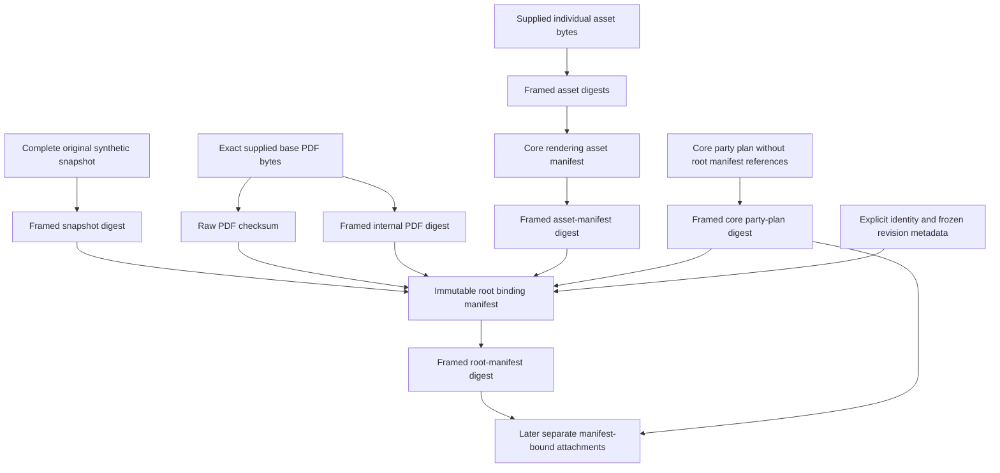

# Digest decision closure package V1

**Owner action: approve, reject or amend C1–C8 below. All are PROPOSED; none is approved by this package. ADR-001 remains PROPOSED and unchanged.** This closes design ambiguities **on paper as recommendations**, not by recording an owner decision or authorizing implementation. Documentation only; no code, tests, hashes, external calls or signing operations.

Sources: [44-entry decision review](rental-contracts-signature-architecture-decision-review-v1.md), [candidate specification](rental-contracts-offline-canonicalization-digest-specification-v1.md), [49 candidate vector rows](rental-contracts-canonicalization-digest-candidate-vectors-v1.md) and [ADR-001](decisions/001-proposed-electronic-signature-evidence-boundary.md). The earlier register and acceptance criteria remain traceable; this package does not repeat or approve the architecture.

## 1. Minimum offline decisions

Proposed **Offline Digest V1** scope: pure, synthetic, in-memory snapshot encoding, exact supplied base-PDF/asset byte hashing and combined-manifest binding. No rendering, PDF parser/safety certification, raw JSON/canonical-byte importer, storage, signature chain execution, real identities/policies, lifecycle integration or trust verification. Outputs remain `trust: unverified`, `canActivateSigned: false`. A matching checksum is not a signature or legal-authority finding.

For that scope, **all eight approvals are necessary**. Deferring operational capabilities does not permit skipping an offline byte/schema/limits/vector decision.

| Item / original decisions | Technically preferred option for owner approval | Alternative and principal risk |
| --- | --- | --- |
| **C1 — scope/targets**: DR-01, DR-03 | Retain independent snapshot-content and exact-PDF identities, joined by an immutable synthetic manifest. No legally authoritative representation selected | Snapshot-only misses rendered bytes; PDF-only misses original typed fields. Combined binding costs more schemas and still cannot prove accurate rendering |
| **C2 — input/compatibility**: DR-04, DR-05, DR-06, DR-07, DR-13, DR-14, DR-15 | Whole captured settings/document; approved strict V1 tagged/untagged/V2/V3 schemas; no conversion. Native plain data only. Reject own undefined, missing required fields and unknown versions. Use existing evidence-codec non-nil UUID syntax for agency/contract, preserving supplied spelling and exact comparisons; keep date text unchanged | Supporting own-undefined archives or raw import needs another explicit schema/import decision. Rejection may exclude previously readable material; preserve it unchanged and report unsupported input rather than repair it |
| **C3 — canonical bytes**: DR-08, DR-09, DR-10, DR-11, DR-12 | Adopt candidate tagged-node grammar, Unicode-scalar key order, unchanged array order, exact UTF-8/control escaping and no normalization/BOM/final newline. Bigint decimal; finite Number binary64 bits including -0. Preserve French/Arabic source scalars and timestamp text | Decimal/fixed-point Numbers or NFC would need a different explicit byte/profile choice and vectors. Binary64 is less human-readable; no normalization intentionally distinguishes visually/canonically similar text |
| **C4 — digests/profiles**: DR-16, DR-17, DR-18, DR-19 | SHA-256, lowercase 64-hex output, proposed length-framed domains for internal digests; also a separately typed raw PDF checksum. Prefer Node 24 built-in crypto for the first offline harness, with an explicitly pinned/reviewed runtime build and independent primitive checks; no custom cryptographic algorithm | Raw-only hashes simplify interoperability but revise the candidate boundary. Node-only harness work does not authorize browser integration or imply certification. Two checksum classes must never be interchanged. Generic evidence V1 syntax remains unchanged |
| **C5 — schemas/graph/revisions**: DR-20, DR-21, DR-22, DR-23, DR-24 | Adopt acyclic core records and the revision rules below; approve exact sidecar schemas before code. Two synthetic parties, agency representative first/customer second; policy binding explicitly null | Root-bound plans create cycles. Omitting provenance/context weakens binding. Live signing authority, extra signers and operational policies remain deferred; synthetic labels provide none of them |
| **C6 — resource limits**: DR-25, DR-44 | Adopt the numeric offline budgets below. Prefer bounded buffers for V1; streaming may be delegated only if bytes/length checks/budgets remain identical | Larger/unbounded inputs increase resource exposure; smaller caps may reject useful fixtures. No truncation or rounding to fit. Streaming is not permission to skip known lengths |
| **C7 — result boundary**: DR-26 | Separate integrity-only interface using candidate `unsupported-profile`, `invalid-input`, `binding-mismatch`, `digest-mismatch`, `ambiguous-input`, `unavailable-input`, `integrity-match-unverified`; caps reject as `invalid-input`. Complete context comparisons, immutable results and unconditional no-trust/no-Signed. Current evidence/resolver semantics unchanged | Reusing `resolved-unverified` as digest success conflates existence with integrity. A digest supplied alongside attacker-controlled bytes does not authenticate an expected value. Exact error precedence still belongs in the approved result schema |
| **C8 — independent vectors**: DR-27 | Approve exact typed inputs, canonical bytes, frame bytes and independently checked digest answers before implementation acceptance; expand the 49 rows into component cases | An implementation-generated oracle can preserve the same bug. Grouped scenarios and visual examples alone are not known-answer tests |

Names containing `draft1` remain **unregistered candidate identifiers** until owner/architect approval freezes their exact definition. Approving this package must specify those identifiers or replacements; no schema-version bump or ADR acceptance is implicit.

## 2. Proposed acyclic dependency graph

Arrows mean “input to”; no child below may contain a reference/digest of a parent computed later.

**Resolved proposal:** core party plan contains its own plan/profile identity, agency/contract/document revision and ordered synthetic party IDs/roles/subject references. It contains **no** `manifestRef`, `manifestDigest`, attempt, live CAS, evidence, signature or verification outcome. Its digest is computed before the root. Asset manifests likewise contain leaf asset identities/digests and rendering metadata, never the root digest.

The root references those already-computed core digests. A later party/attempt attachment may reference both root and plan digests, but is **never fed back** into the core plan, asset manifest or root. Attachments are not implemented in Offline Digest V1. This resolves the proposed manifest↔party-plan cycle without silently excluding a field from an already-approved record. The exact core/attachment schemas still require C5 approval.

V1's root has mandatory `policyBinding: null` and `mode: offline-synthetic`: no approved signing/authentication/consent policy is fabricated. A future non-null policy binding requires a separately reviewed core-policy schema/domain, computed before the root and excluding root/attachment references. It cannot be backfilled into a frozen V1 manifest. Validate the whole graph for duplicate/conflicting IDs, missing nodes and direct/transitive cycles; never iterate hashes until a cycle appears to settle.

Proposed computation order: validate all explicit inputs and scope → snapshot/asset/PDF byte identities → core asset manifest and core party plan → root manifest → stop. No parent digest includes itself, directly or indirectly. Bare mutable references cannot replace required content digests.

## 3. Revision and PDF identity rules

| Value | Proposed meaning / rule |
| --- | --- |
| `documentRevisionId` | Immutable agency+contract-scoped finalized document edition. Any content, captured settings, party plan, rendering configuration or replacement base PDF requires a new edition/package; do not overwrite the old one |
| `aggregateRevisionAtFinalization` | Positive safe-integer **resulting revision after** the finalization operation; frozen in the root |
| Live `aggregateRevision` / expected CAS | Separate current concurrency token in command/evidence context; may advance without changing the finalized snapshot/root. Never insert it into, or rewrite, the frozen root |
| Captured settings `revision` | Independent nonnegative safe-integer source field; preserve exactly, including 0. It is not document revision or live CAS |
| `attemptId` / `attemptGeneration` | Separate later intent/eligibility context, not root inputs. No attempt/challenge/signing records are created by this milestone |

Illustration only: finalization may yield aggregate revision **2**, followed by pending at live revision **3**. The root remains bound to finalization revision 2; current evidence context may require CAS 3. Equality between those two tokens is **not** an invariant. In an eventual authority boundary, their relationship must be validated against retained finalization/current-state records. Offline fixtures only compare explicit synthetic context and cannot authenticate that relationship. No service/ID/revision generator or lifecycle modification is proposed here.

PDF semantics proposed for C4:

| Identity | Exact computation proposed | Permitted use |
| --- | --- | --- |
| `rawPdfChecksum` | Ordinary SHA-256 over **all supplied PDF file bytes**, unframed; lowercase 64-hex | External file-checksum comparison only; no person/provider-signature claim |
| `baseArtifactDigest` | SHA-256 over the candidate frame with domain `cp.pdf.exact-bytes.draft1` and those same complete bytes | Internal artifact identity and root binding; not interchangeable with raw checksum |
| Provider/signature hash | **Out of scope**; may cover signed byte ranges or a different algorithm/profile | Must later be independently verified under an approved signature profile; never substituted for either checksum above |

Both raw and framed PDF descriptors are included in the proposed root. The raw checksum uses a **separate record type**, proposed profile `cp-pdf-raw-sha256-draft1`, with `profileId`, `algorithm`, `encoding`, `value`; it does not pretend an unframed hash has a cryptographic domain tag. It is not inserted into current `SigningEvidenceDigest`. Internal descriptors retain `algorithm`, `encoding`, `domainVersion`, `value`. Compare the full typed/profile descriptor, not just 64 hex characters.

Use the candidate's exact ASCII magic/NUL/U32BE-tag-length/tag/U64BE-payload-length/full-payload frame. Internal domains remain the proposed snapshot, PDF, asset and rendering-asset/root-manifest domains. Add **proposed** `cp.party-plan.typed-json.draft1` for the acyclic core plan; owner approval must register it before implementation. No raw-hash fallback, PDF metadata stripping, font repair, text extraction or re-rendering. Different framed preimages are not a mathematical guarantee of collision impossibility.

## 4. Required schemas and proposed offline budgets

C5 needs exact, closed field/type definitions, not just a group diagram:

- **Source adapters:** complete captured settings/document for V1 tagged/untagged/V2/V3; field ranges/nullability, own-property presence and all historical fields. Current presentation-version dispatch is not this validator. Reject own undefined without deleting it or rewriting source.
- **Core asset manifest:** profile/mode/manifest identity; entries with asset ID, role, version, exact bigint byte length and framed leaf digest; renderer/build/template/font/locale/timezone/print-profile metadata. Prefer unique asset IDs in strictly ascending Unicode-scalar order; reject unsorted entries rather than silently reorder an array. Only explicitly supplied local buffers; no asset discovery, file reads or remote lookup.
- **Core party plan:** fields described in section 2; exactly two ordered synthetic required parties. No identity proof, real authority or consent fields. Full field inventory and allowed roles/order must be fixed before implementation.
- **Root sidecar:** profile/mode; agency/contract/document revision; finalization revision; resolved source schema and original tag presence; snapshot reference/digest; base-artifact reference, media type and bigint byte length; raw checksum and internal artifact digest; core asset/party references and digests; `policyBinding: null`; explicit nullable prior-edition reference. Exclude its own digest, live CAS/attempts, audit outcomes, signatures and generated dates.
- **Registry/result:** exact allowed profiles/domains/schema versions and output/rejection contract. Bigint byte lengths, Number revisions and preserved original snapshot types are deliberately distinct. No unknown-key extensions to evidence V1; future sidecar integration needs its own compatibility review.

These schema deliverables remain entry blockers until reviewed; this compact package does not silently fill in omitted fields or make its lists executable schemas. Core/reference IDs are supplied fixture labels, not authoritative identities. All five existing template IDs must remain distinguishable when rendering metadata is present.

Schema approval must include cross-record equality constraints: agency/contract/document revision wherever present must match the root; core party assignments must match their explicit context; declared template/render configuration must agree with the captured snapshot and supplied render context. An approved rule must describe any source-logo representation to retained-image-byte relationship. These checks still cannot prove PDF visual/content equivalence or actual rendering provenance.

**Proposed initial offline caps, all pending owner/security approval:** 1 KiB = 1,024 bytes; 1 MiB = 1,048,576 bytes. These are resource budgets, not business/legal limits or measured production sizing.

| Budget | Proposed cap |
| --- | --- |
| Canonical UTF-8 snapshot output | 2 MiB |
| Each canonical root, core asset manifest or core party plan output | 256 KiB |
| Supplied base PDF | 16 MiB; one base artifact per package |
| Each supplied asset / asset count | 4 MiB / 128 assets |
| Total supplied PDF+asset bytes and total emitted canonical bytes for one package | 64 MiB combined; charge every supplied/emitted entry, no assumed alias/dedup discount |
| Source-value depth / total nodes across all structured package inputs | 32 / 50,000; root is depth 1, each scalar/container counts once, keys do not count as value nodes |
| Per-object members / per-array entries | 256 / 1,024, with stricter approved field limits still applied |
| Per-key UTF-8 bytes / per-string UTF-8 bytes | 256 / 512 KiB, with stricter source-field limits still applied |
| Bigint decimal digits | 256 digits excluding sign; schema/business range rules still apply |

Current stricter field constraints—such as configured-condition/logo limits, two parties and V3's 50 markers per stage—are preserved, not widened by these generic caps. Reject before expensive work when possible; enforce output caps during encoding. Never clip content, round values or skip fields to fit. Oversized legitimate fixtures remain unchanged with an explicit rejection; changing caps needs scope/profile review and new boundary vectors. Total memory/CPU acceptance must be measured later on the agreed offline reference environment; these byte/node caps do not claim a peak-memory or runtime guarantee.

## 5. Required independently checked vectors

Retain traceability to all [49 candidate rows](rental-contracts-canonicalization-digest-candidate-vectors-v1.md), but split them into exact codec, framing/digest, source-schema, context-binding and deferred signature/content-policy cases. P05/P06 and trusted-time/legal assertions are not digest-known-answer requirements. Scope exclusions must be recorded, not reported as passed.

Before implementation acceptance, require:

1. Complete synthetic V1 tagged/untagged/V2/V3 snapshots, fractional marker values, bigint money, preserved FR/AR scalars, all five template labels, raw supplied PDF bytes and complete acyclic manifests. Include zero/absent/null cases, rejected own undefined, type distinctions, -0/finite edges, key ordering, bad Unicode and unsupported profiles.
2. Exact source types/scalar lists, canonical byte lengths/hex, full frame bytes/lengths, expected raw/internal digest descriptors or fixed rejection. Cover magic/NUL/endianness, empty buffers, cap−1/cap/cap+1, length mismatch/overflow, cycles, revision/tenant/render substitution and raw/framed/provider-class confusion.
3. Independent primitive known answers **and** separately checked encoder/frame outputs. Two libraries hashing the same wrongly assembled frame are insufficient. Do not generate the oracle from the implementation under test.
4. A versioned corpus disposition with identified owner/architect and independent reviewer, exact profile/corpus revisions and zero unresolved discrepancies. No such reviewer identity, result or approval is fabricated in this package.

Preparing/checking those bytes and digests is a **later separately authorized task**. There are no computed known-answer digests here. Profile/schema approval must precede oracle work; approved independently checked answers must precede acceptance of the implementation using them.

## 6. Deferred decisions and complete traceability

The C-table explicitly maps **DR-01, DR-03–DR-27 and DR-44** to the eight offline items. For clarity, each remaining original decision is retained below; there are no unmapped IDs among DR-01–DR-44. Mixed decisions' operational portions remain deferred even if their offline subset is approved.

| Original ID | Deferred or delegated scope; not an Offline Digest V1 prerequisite |
| --- | --- |
| DR-02 | Legal-authority selection/adjudication; owner/legal review before real use. Offline scope explicitly excludes such a conclusion |
| DR-28 | Authenticated expected values, tenant authorization and authoritative current context; fixtures supply untrusted labels only |
| DR-29 | Real signer/agency-person proofing and authentication assurance |
| DR-30 | Real session/invitation/reauthentication/revocation and capture-race policies |
| DR-31 | Live Owner/Staff/service capabilities and representative mandates |
| DR-32 | Real FR/AR consent/intent texts, affirmative actions and one-use challenges |
| DR-33 | Signature/device/providerless method, cryptographic signature verification and key custody |
| DR-34 | Trusted-time authorities, precision, revocation/order verification and retained proof |
| DR-35 | Authenticated verifier decisions, separation of duties and later reliance suspension |
| DR-36 | Provider/account choice, callback authentication, keys, replay/freshness and external retrieval |
| DR-37 | Durable request fingerprint profile, idempotency/operation IDs/outbox/inbox, ambiguous external outcomes and reconciliation |
| DR-38 | Durable audit/state/evidence commit, independent anchors, recovery and disposal |
| DR-39 | Authoritative PDF rendering/freezing, content/safety validation, signed updates and ByteRange verification; supplied bytes can be hashed without claiming these capabilities |
| DR-40 | Real personal-data hosting/access/export/retention/legal/privacy decisions; no real data in offline fixtures |
| DR-41 | Operational architecture acceptance, incident ownership, activation and release |
| DR-42 | Delegate module/helper/fixture paths within the approved pure boundary; no byte/profile changes |
| DR-43 | Delegate local runner/test layout and human-readable presentation; C7 still fixes machine-readable errors/privacy |

Operational parts of **DR-04, DR-07, DR-13, DR-16, DR-18, DR-21–DR-24 and DR-26** remain outside offline approval: no operational projection, authenticated identity/revision, time/authority, live renderer, signing plans or trust transition is supplied. **DR-44** permits internal buffering/streaming preference only after C6 fixes identical output and resource constraints. This is traceability to the original review, not a replacement 44-entry review.

## 7. Owner approval checklist and implementation entry

All boxes are intentionally unchecked. No elapsed time, silence, prior test pass or document delivery is approval. Owner may approve/reject/amend each grouped choice and must identify the technical/security reviewer responsible for its closure.

- [ ] **C1:** Approve the exact synthetic-only combined-binding scope; acknowledge no legal-authority choice, real data or signing authorization.
- [ ] **C2:** Approve native input schemas/version handling, lossless source preservation, rejected own undefined, exact ID/date handling and exclusion of raw import.
- [ ] **C3:** Approve the referenced tagged grammar, Unicode/number/order/UTF-8 rules and exact draft profile identity.
- [ ] **C4:** Approve SHA-256/framing/domain registry, distinct raw/internal PDF types and independent primitive/provenance review.
- [ ] **C5:** Approve complete sidecar/core schemas, the acyclic graph, finalization/live revision split, explicit null policy binding and no attachment implementation.
- [ ] **C6:** Approve or replace every numeric budget above, its counting rules and the offline reference environment for measured resource acceptance.
- [ ] **C7:** Approve fixed integrity-only outputs/errors and preservation of current evidence V1, resolver, lifecycle and PDF behavior.
- [ ] **C8:** Approve corpus responsibilities, independent verification method, discrepancy process and corpus acceptance requirements.

Record choices against C/DR IDs and exact document/profile/corpus revisions, selected alternatives/risks, actual accountable reviewers and explicit exclusions. An owner's approval of **choices** is distinct from completion of missing schema/oracle deliverables, and from separately authorizing implementation. Do not create an approval signature/timestamp or change ADR-001 in this task.

**Entry criteria for a later Offline Digest V1 implementation:** C1–C8 choices explicitly approved; all referenced exact schemas/registry/limits/error contracts completed and approved; scope reconciled explicitly with earlier C0–C7 gates; independent encoder/frame/digest corpus ready and approved for each implemented component; reviewed primitive/reference environment identified; explicit separate implementation task authorized. No blank schema, limit, oracle or deferred operational dependency may be silently guessed. Any staged subset needs its own explicit capability exclusions and entry criteria.

Later acceptance must demonstrate the approved known answers, deterministic bytes, immutability, ambiguity/mismatch rejection, budget boundaries and unchanged no-trust/no-Signed behavior, plus focused/full rental regression, TypeScript, lint and whitespace checks. Pure integrity results can satisfy none of the deferred real-signing gates by themselves.

**GO — owner review and decision capture. NO-GO — Offline Digest V1 implementation until the entry criteria are satisfied. Real signing and Production remain NO-GO; ADR-001 remains PROPOSED.**
