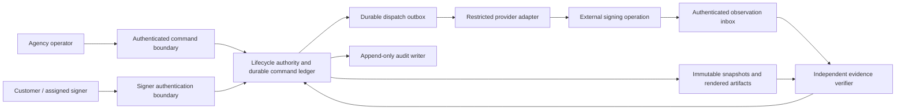

# Electronic signature architecture V1

Status: **PROPOSED — DESIGN ONLY**. Reviewed 2026-11-21 UTC. **Production and real signing remain NO-GO.** No signing, consent, audit event or signing timestamp is created by this document.

## Scope and linked proposals

This architecture concerns future Moroccan car-rental contracts. It preserves the current offline implementation and the existing **agency first, customer second** ordering in [the repository architecture](architecture.md). It selects no provider and makes no claim that a particular method is legally sufficient.

- [Transition, evidence and security decisions](decisions/001-proposed-electronic-signature-evidence-boundary.md).
- [Signing evidence schema proposal](rental-contracts-signing-evidence-schema-v1.md).
- [Provider integration boundary](rental-contracts-signing-provider-boundary-v1.md).
- [Threat model and negative acceptance tests](rental-contracts-signing-threat-model-v1.md).
- Existing [audit-event contract](rental-contracts-future-audit-event-contract-v1.md) remains the audit envelope; the present proposal supplies signing-specific constraints without implementing it.

### Current baseline, not future functionality

The [offline lifecycle](rental-contracts-offline-lifecycle-v1.md) and [acceptance review](rental-contracts-offline-lifecycle-acceptance-audit-v1.md) establish Draft → Finalized → Signing pending only. `contract-lifecycle.ts` rejects Signed; evidence is null. Snapshot V1/V2/V3 objects contain demonstration data and unsigned placeholders. Object freezing is local immutability, not durable integrity, identity verification or legal execution.

`ContractPdfExport` calls browser printing. It does not observe the saved PDF bytes or confirm a download. The existing demo renderer includes demonstration/unsigned disclaimers. None of those records or artifacts may be promoted to operational signing by flipping `demonstration`, removing a watermark, assigning a number or accepting a new state string. A future operational projection, decoder, approved renderer and authoritative authorization boundary require separate review. Existing simulation guards must stay intact.

## Moroccan context and separate legal gate

DGSSI identifies Law 43-20 as governing electronic trust services and provides implementation/reference materials. Its FAQ distinguishes simple, advanced and qualified signatures, and distinguishes a person's signature from an organization's seal. These categories are context for method assessment, not a finding that any proposed flow suffices for rental contracts. [DGSSI law page](https://www.dgssi.gov.ma/fr/textes-legislatifs-et-reglementaires/loi-ndeg-43-20-relative-aux-services-de-confiance-pour-les/), [DGSSI FAQ, questions 15–16](https://www.dgssi.gov.ma/sites/default/files/legislative/brochure/2024-10/FAQ%20relatif%20%C3%A0%20la%20loi%2043-20__v1.1.pdf).

Before implementation involving people or providers, qualified Moroccan legal/privacy review must establish the applicable current texts, method/assurance classification, representative authority, contract formalities, approved FR/AR wording, evidentiary requirements and appropriate retention. Provider marketing or recognition in another jurisdiction is insufficient. No legal method or qualification is selected here.

CNDP guidance addresses processing purposes, retention and international transfers. Identity, contact, signature, authentication and provider evidence therefore require a documented processing/hosting assessment, including any applicable notification/authorization steps. No numeric statutory retention period or blanket transfer permission is assumed. [CNDP conditions](https://www.cndp.ma/conditions/).

## Trust boundaries and responsibilities

Names are conceptual ports, not implemented workers or public routes. Domain policy must have no browser/provider SDK dependency. Application orchestration owns authorization, expected revisions, idempotency and consistent state/event commits. Restricted infrastructure owns credentialed dispatch/storage. The verifier can read approved artifacts/trust material and propose a verification decision; it cannot silently rewrite content or act as a customer. The lifecycle authority alone may commit an accepted transition.

No browser, callback body, agency selector, email link, dashboard role label or provider status flag is authoritative by itself. Platform administration does not inherit agency signing rights.

## Identities, authentication and authorization

### Agency Owner and Staff

Use an authenticated, stable person subject plus an active agency-membership record and explicit capabilities. Check session validity, membership/revocation version, contract ownership and requested capability at each sensitive command and again at commitment. An identity-provider login alone is not agency authorization. Existing offline Owner/Staff strings are not credentials.

| Capability | Proposed permission boundary |
| --- | --- |
| View/edit a draft | Owner or specifically authorized Staff, in the selected agency and permitted contract scope |
| Finalize | Explicit `contract.finalize` capability; fresh strong authentication and current revision |
| Prepare/cancel a signing request | Explicit `signature.request` / `signature.cancel`; current authority and step-up |
| Sign for the agency | A named natural person separately assigned as agency representative, with verified identity and evidence of authority; Owner status alone is insufficient |
| View/export evidence | Explicit evidence-read scope; audited access; stronger separation than ordinary template administration |
| Verify evidence / commit Signed | Restricted internal service identities and policy checks; no dashboard override |

Owner may administer permitted agency capabilities but cannot manufacture consent, attest their own verification result or turn an organizational seal into a person's signature. Staff has no implicit signature-request or representative authority merely because offline draft creation is allowed.

### Customer and signer-to-contract binding

Finalize a required-party plan: named agency representative first, primary customer second. Secondary-driver data does not automatically designate another signing party. Additional required signers or representative substitutions require an explicitly reviewed new plan/version; never infer identity from a CIN/passport field, driver label, phone number or uploaded image.

Bind each party instance to a verified subject, role, agency/contract/document revision, signing session/attempt, authentication-policy version, exact manifest/artifact and single-use challenge. Operator identity and actual signer identity remain separate even when they refer to the same person.

An invitation is an opaque locator only. Possession, forwarding, opening or redeeming a link does not prove civil identity or authorize access to the contract. Require the assigned signer's authenticated/proofed subject before disclosing document data or allowing consent/capture. Link scanners must not sign or consume a signing challenge. Store locator secrets as hashes; exclude them from URLs forwarded to analytics, logs and referrers. Generic expired/revoked responses must not enumerate customers/contracts.

Identify a signer through an independently approved proofing process, then authenticate that subject at capture using the approved method. An email/SMS OTP can demonstrate channel possession; it does not by itself establish civil identity, representative authority, consent or legal sufficiency. Recovery must not reduce the assurance requirement or allow support staff to mark a signer verified without a controlled re-proofing path.

### Session policy and revocation

Proposed application security defaults, requiring policy approval before any implementation involving real subjects: agency session idle limit 15 minutes / absolute limit 8 hours; signer session idle limit 10 minutes / absolute limit 30 minutes; critical-action reauthentication and one-use capture challenge at most 5 minutes old. Prefer phishing-resistant MFA for agency critical operations; signer proofing/authentication must meet its separately approved assurance profile. These are project design choices, not Moroccan legal thresholds or a claim of NIST assurance certification. NIST provides relevant session-binding/reauthentication guidance. [NIST session management](https://pages.nist.gov/800-63-4/sp800-63b/session/), [NIST authentication guidance](https://pages.nist.gov/800-63-4/sp800-63b.html).

Use protected, server-managed sessions; secure/HttpOnly/SameSite cookies where applicable, rotation after authentication/privilege changes, CSRF protection, origin checks, rate limits and no tokens in persistent browser storage. Require server-side expiry and revocation checks, not just a cryptographically valid old token. Invitation lifetime is a separate, explicitly configured policy and cannot extend a login session.

Expired sessions require fresh authentication; revoked sessions/agency membership/challenges deny new actions. Close outstanding authorization permits and fence the relevant attempt when cancellation, identity compromise or authority withdrawal requires it. No offline bypass or weaker fallback during identity/provider outages.

A callback is authenticated as a service observation, not with an expired user's browser cookie. Routine browser expiry after a timely, verified capture does not erase that historical fact. Acceptance must prove the authorization was valid at the actual capture and that the attempt was not fenced/superseded. If revocation/capture ordering or compromise is uncertain, hold the evidence for reconciliation. Never infer that a late provider timestamp preceded revocation. Counsel determines any legal effect of an already captured signature; software cancellation is not retroactive legal erasure.

## Versions, finalized content and artifact binding

Keep distinct identifiers for contract series, immutable document revision, aggregate/CAS revision, presentation schema V1/V2/V3, signing attempt, required-party plan, evidence schema and policy/renderer versions. Current `revision` is an in-memory concurrency token, not all of these concepts at once.

Freeze an authoritative signing package with:

- A losslessly encoded operational data/settings snapshot and `snapshotDigest`.
- Exact approved rendered PDF bytes and `baseArtifactDigest`.
- A manifest binding both digests, agency/contract/document revision, rendering/template/font/asset versions, locale, required parties/order and policy version; `manifestDigest` binds that manifest.

Canonical encoding must preserve bigint amounts, null/missing distinctions, exact configured text/line breaks and V1/V2/V3 semantics; no float conversion, historical rewriting or silent Unicode/text normalization. Define algorithm/version/domain separation and fixed conformance vectors before relying on any hash. Proposed baseline is SHA-256 with explicit digest metadata; this does not replace a signature or a trust policy.

Render once, validate content/layout, then retain those exact bytes immutably. Reprinting can generate different PDF metadata/bytes even when visually identical. Do not re-render later and pretend the bytes are the artifact reviewed and signed. A manual browser print does not provide an observable authoritative artifact; the future freeze pipeline is a separate prerequisite. Do not force one page by clipping long content.

Agency signs the base artifact first. After verification, freeze the agency-signed intermediate artifact. Customer reviews and signs that exact intermediate artifact. Record every input/output digest in the signature chain. Final PDF bytes normally differ from unsigned bytes because of permitted cryptographic updates. An approved profile must verify the base content and each authenticated update, allowing only specified signature/timestamp/approved appearance changes. Reflow, new clauses, altered prices or provider typesetting is forbidden. If a provider cannot supply verifiable binding to this chain, it cannot satisfy the gate.

The base manifest stays immutable. Later party presentation/operation records bind its digest plus the exact intermediate artifact digest; they do not rewrite the finalized manifest. Keep a provider's audit certificate or evidence appendix as a separately hashed evidence artifact unless its incorporation was explicitly included in the approved package/profile. Do not silently append new contract pages or legal wording after review.

### Modifications after finalization

No in-place edits, replacement files, changed terms, signer substitutions or mutable settings references. Create a new immutable document revision, explicitly linked to the previous revision, then finalize it and obtain new intent/consent/authentication. The old snapshot and evidence remain historical facts.

Before accepting a new revision for signing, atomically supersede/fence all active attempts for the old revision locally; request provider cancellation as a separate operation. Cancellation timeout does not keep the old attempt eligible. Late evidence remains bound to its old revision and is quarantined from the new revision's Signed decision. Never copy partial signatures/consent to the replacement revision. A previously Signed revision remains preserved; an amendment/new revision does not overwrite or silently “unsign” it.

## State transition and evidence matrix

The following describes future behavior only. Existing offline Signed rejection is unchanged.

| From / action | Required basis | State result |
| --- | --- | --- |
| Draft / edit | Authenticated scope, edit capability, current aggregate revision | New draft revision; no signing evidence |
| Draft / finalize | Finalize capability, reviewed complete snapshot, frozen approved PDF/manifest/party plan, durable storage and consistent audit commit | Finalized; no consent/signature inference |
| Finalized / prepare signing intent | Request capability, fresh authorization, idempotent command, immutable package, explicit active attempt | Signing pending, session `prepared`; does not claim dispatch |
| Pending / provider accepts request | Authenticated operation receipt and exact request binding | Pending; session `dispatched`; not signed |
| Pending / agency evidence accepted | Verified agency-person proof bound to base content and current attempt | Pending; agency-verified intermediate artifact; customer operation may now be prepared |
| Pending / customer capture observed | Authenticated observation only | Pending until independently verified; a callback is not the final decision |
| Pending / accept complete evidence | **Every condition in predicate S below** | Signed for that exact revision, as an internal evidence status |
| Any / print, view, download or click | Read authorization where applicable | No signing state change; no evidence of consent/capture/saving |
| Pending / fail, cancel, expire or uncertain operation | Authenticated facts / explicit authorized intent; attempt fenced where required | Never Signed; preserve primary state/history and show the session substatus clearly |
| Any / missing, rejected, substituted or unresolved evidence | No complete trusted decision | No Signed transition; reject or quarantine |

Failure, cancellation, expiry, preparation, dispatch, partial capture, reconciliation and supersession are signing-session substates, not hidden successful contract transitions. A pending contract with no active attempt must explicitly say “inactive/cancelled/expired,” not imply an outstanding successful request. A new attempt requires an explicit authorized command and new challenge/consent; no automatic restart.

### Predicate S: the only future authorization for Signed

All conditions are conjunctive and evaluated by the authoritative service; a caller-supplied `verified: true` can satisfy none of them:

1. An operational, non-demonstration package exists; current contract state is Pending and the active attempt/document revision and expected aggregate revision match.
2. Deployment/use-case policy, method, provider account and verifier profile are approved and still enabled. Required policy parameters are defined; missing parameters fail closed.
3. Exact immutable snapshot, manifest, base/intermediate/final artifacts and all digests match. The validated agency-first/customer-second chain contains no unauthorized content change.
4. **Every required party** has verified identity, role/authority, appropriately fresh authentication at capture, explicit approved consent and separate signature intent, all bound to the same party plan, manifest and valid one-use challenge. No required signer is inferred or omitted.
5. Signature evidence and its source/operation binding are independently verified; all required cryptographic/trust/certificate/revocation checks for the selected profile pass. A drawn mark, consent checkbox, login or provider `completed` field alone is insufficient.
6. Each capture has a verified trusted-time proof bound to its signature/artifact, meeting the approved time profile. A browser time, audit receipt time or unauthenticated provider date cannot replace it.
7. Evidence was valid for the authorized capture and its ordering; no unresolved revocation, mismatch, cancellation race, stale revision, replay conflict, compromise or supersession remains. The attempt is eligible under the local cancellation/revision fence at acceptance.
8. An internal verifier decision binds the complete evidence set, artifacts, policy/verifier/trust-material versions and disposition. It is authenticated, fresh under policy, and not rejected, quarantined or invalidated.
9. Evidence/artifacts are durably retained and accessible under policy. Commit the state change, one aggregate-revision increment, decision reference and append-only applied audit event consistently, using idempotency/CAS to prevent duplicate acceptance.

Partial success remains Pending. Repeat delivery of the same accepted decision returns its authorized receipt, not another transition. Conflicting second evidence is retained/quarantined rather than silently replacing the accepted proof.

“Signed” means the service accepted evidence under a named technical policy. It is **not an automatic assertion of legal validity**. Preserve separate legal-review metadata and an assurance/reliance status. If later trust compromise challenges evidence, preserve the historical decision, suspend reliance and require a new reviewed verification disposition; do not silently erase evidence or keep displaying an unconditional verified badge.

## Durable audit and privacy

Use the existing [audit-event contract](rental-contracts-future-audit-event-contract-v1.md), not a competing event format. Bind authenticated actor, agency + contract, action, expected/observed/resulting revisions, state changes, timestamp source, exact snapshot/evidence references and idempotency/fingerprint. Keep intent, dispatch, capture observation, verifier acceptance, Signed commitment and print request distinct.

Applied events must be consistent with state changes; raw observations may be retained separately with provenance and a reference. Require append-only access, separation of writer/read/export roles, encrypted evidence storage, managed key custody, integrity checks anchored outside a writer's unilateral control, restoration tests and correction-by-reference. A hash chain alone is not protection if an administrator can rewrite both events and its anchor.

Retention requires documented purpose/category schedules, legal hold, applicable CNDP/other legal review, controlled export and auditable disposal. Avoid full identity documents, raw signature/biometric material and secrets in general logs; prefer protected references/digests. “Append-only” does not mean indefinite retention of all personal data. Evidence deletion/crypto-erasure and key loss must be explicit, authorized dispositions; retained metadata must not keep asserting that unavailable evidence is fully verifiable.

## Prerequisites and GO/NO-GO gates

| Gate | Evidence required before crossing it | Present decision |
| --- | --- | --- |
| G0 — scope and legal/privacy policy | Reviewed Moroccan use case/method, authority/party policy, FR/AR consent wording, data/hosting/transfer/retention assessment | NO-GO for real data/signing |
| G1 — identity and tenancy | Authenticated subjects, current memberships/capabilities, revocation/recovery/step-up policy, cross-agency negative tests | Not implemented by offline roles |
| G2 — immutable operational package | Non-demo authoritative projection, canonical hash vectors, frozen approved artifact/renderer and supersession tests | Manual print is insufficient |
| G3 — durable commands/audit | Consistent revision/state/event operations, idempotent receipts, outbox/inbox integrity and recovery tests | Current memory service is insufficient |
| G4 — provider/time/verifier profile | Reviewed provider capability/trust/privacy evidence; independently tested identity, integrity, ordered signature and trusted-time verification | No provider selected or contacted |
| G5 — controlled integration validation | Approved environment/credentials, synthetic end-to-end faults, ambiguous outcome and revocation races, security review | Requires separate explicit authorization |
| G6 — activation | All prior gates, operational monitoring/incident response and release approval | Production and real signing NO-GO |

Passing design review alone crosses none of G1–G6. No production feature flag, endpoint, credential, provider call or Signed transition is added here.

## Small, independently testable offline roadmap

Every milestone requires a separate implementation task; synthetic fixtures only, no live credentials/providers/databases, and existing offline Signed rejection remains intact throughout.

| Milestone | Bounded deliverable | Independent acceptance |
| --- | --- | --- |
| M0 | Review ADR, party/auth/time/privacy policy and unresolved decisions | Named reviewers approve or reject each gate; no legal sufficiency inferred |
| M1 | Pure canonical snapshot/manifest codec and digests | V1/untagged-V1/V2/V3, bigint, null/missing and exact FR/AR text vectors; one-field tampering fails |
| M2 | Frozen artifact fixture manifest and revision/supersession policy | Retained bytes vs re-render differ correctly; no content clipping; stale artifact/party plan cannot bind |
| M3 | Pure evidence-proposal decoder and policy evaluator | All predicate-S omissions reject; no writable verification flag; no real consent/signature capture |
| M4 | In-memory identity/capability/revocation policy harness | Explicitly synthetic subjects; expired/revoked/cross-agency/challenge-replay cases; no authentication integration |
| M5 | In-memory command ledger/outbox/inbox simulator | Duplicate keys, different fingerprints, timeout/unknown IDs, lost/out-of-order observations; no network dispatch |
| M6 | Fixture-only verifier/profile interface and ordered artifact-chain checks | Bad/unknown time/trust, swapped evidence, partial parties and supersession races; synthetic verification is never treated as real proof |
| M7 | Audit-envelope conformance and recovery model | State/revision/event consistency, failed writes, append-only corrections, retention/hold policy; no fabricated operational events |
| M8 | Offline browser acceptance of design-state/read-only explanations | Keyboard/FR/AR, consent/intent distinctions using clearly labeled non-capturing mock UI, print invariance, all five PDF fixtures |

Only after those independent results and separate approval may a provider-specific sandbox plan be proposed. That later plan must define its permitted data/calls and cannot be inferred from this roadmap.

## Documentation verification

Only this documentation set is created. Existing implementation/tests remain untouched. Documentation links, field/transition consistency, absence of populated evidence examples and whitespace are checked separately; earlier 652-test acceptance evidence is historical and is not presented as a new signing-architecture test run.

Validation on 2026-11-21: all five new documents passed local file-link, UTF-8, fenced-block and trailing-whitespace checks; `git diff --check` passed. SHA-256 comparison against the pre-edit baseline confirmed all 165 inspected source, test and preview files unchanged. Runtime tests/builds and browser/PDF checks were not rerun for this documentation-only change.
