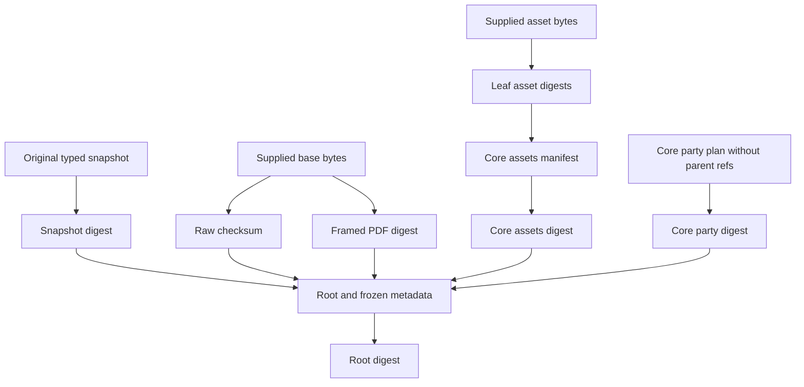

# Offline digest pre-implementation closure V1

Status: **PROPOSED technical specification and isolated reference verification**, 2026-11-21. **C1–C8 are accepted only as a technical review baseline, not formal owner approval. ADR-001 remains PROPOSED. No production digest implementation, existing source/test changes, browser/PDF generation, provider/network/database operations or Signed activation.**

## 1. Delivered artifacts and authority

The exact machine-readable proposal is [schemas-and-registry.proposed.json](../verification/offline-digest-preimplementation-v1/schemas-and-registry.proposed.json). It contains 67 explicitly named native-type definitions, closed field inventories, nullable unions, bounded primitive types, schema references, predicate names, registry identifiers, limits and candidate error precedence. This is a **native schema DSL, not JSON Schema**; it describes Number/bigint without pretending ordinary JSON preserves those types. Its predicates and cross-record requirements below are part of the proposal. No identifier is registered/approved by its presence in this file.

The [isolated workspace README](../verification/offline-digest-preimplementation-v1/README.md) lists every script, corpus/report file, reproduction command and independence limitation. The [decision closure baseline](rental-contracts-digest-decision-closure-package-v1.md), [44-entry review](rental-contracts-signature-architecture-decision-review-v1.md), [candidate codec specification](rental-contracts-offline-canonicalization-digest-specification-v1.md), [49 source rows](rental-contracts-canonicalization-digest-candidate-vectors-v1.md) and [evidence proposal](rental-contracts-signing-evidence-schema-v1.md) remain unchanged.

The scripts are finite, fixed-corpus reference oracles outside the application, with no exported digest API or application imports. They implement experimental reference calculations only under this task's explicit authorization. They must not become the future production implementation or its sole oracle. Supplied identifiers are synthetic labels, not authenticated identities. No signing attempts, consent, signature proofs or trusted timestamps are instantiated.

## 2. Exact schema proposal

### Common rules and native notation

All records are closed. Every field in a DSL `fields` map is required unless listed in `optional`; all current object definitions have empty optional lists. Nullability exists only through an explicit `union` containing `null`. The untagged V1 variant is a distinct closed schema **without** `schemaVersion`, not a missing-required-field default. Unknown keys, wrong types, own undefined, sparse arrays and unsupported versions reject, never disappear. Native data must have ordinary object/array prototypes and own enumerable data properties only, no symbols/accessors/classes/cycles. The AST corpus cannot independently prove that last native-JavaScript boundary; it remains UNVERIFIED.

DSL: `literal` requires the exact primitive type/value; `enum` is exact and does not coerce bool/Number/bigint/string. `number` means finite native binary64; `integer` means a safe integer. `bigint` is native arbitrary-precision integer subject to 256 decimal digits excluding sign; it is never a Number or implicitly parsed string. `array` preserves order and has a maximum; `tuple` fixes exact length and per-index type. `object` validates every own key and every required field. References name another definition; unknown names fail. No schema adapter changes source values.

Identifiers: agency/contract UUID-shaped ASCII syntax as current evidence V1, excluding nil, no asserted RFC variant/version, preserving original case. Equality is exact string equality; no lowercasing or agency fallback. Local IDs/profile labels match `[A-Za-z0-9][A-Za-z0-9._:-]{0,127}` as a whole string. Do not interpret labels as URLs or dereference them. All text must consist of Unicode scalars and satisfy both field-level UTF-16 restrictions where declared and global UTF-8 limits. Strings/date text are not normalized or rewritten.

### Snapshot variants (complete captured settings/document)

The definitions `snapshot-v1-untagged`, `snapshot-v1-tagged`, `snapshot-v2`, `snapshot-v3` each require exactly `{demonstration: true, settings, document}`. Settings and document agencies must match the explicit context. Existing signing-evidence V1 remains a reference schema; these are separate **PROPOSED** source-schema definitions, not a version change to it.

| Definition / exact fields | Types and bounds |
| --- | --- |
| `settings`: agencyId, revision, template, logo, primary, accent, company, conditions, footer | UUID; Number revision 0…MAX_SAFE_INTEGER−1; template enum classic/luxury/modern/detailed/bilingual; nullable logo; two exact six-hex CSS colors; company below; exact conditions/footer text |
| `company`: name, ice, ifNumber, rc, address, city, phone, email | All original strings. Validate a temporary trim view as below; serialize the original, not trimmed/lowercased values |
| Every `document`: demonstration, agencyId, rentalId, number, primaryDriver, secondaryDriver, vehicle, rental, inspection, signatures | `true`; two UUIDs; number string or null; version-specific driver/vehicle/inspection; secondaryDriver nullable; no defaults |
| Version tag | Untagged V1: key forbidden. Tagged V1: Number literal 1 required. V2/V3: Number literal 2/3 required. Own undefined rejects in every variant; archive remains unchanged |
| V1 driver: name, identity, licence, licenceDates, address | All strings, retained combined historical forms |
| V2/V3 driver: fullName, cin, passportNumber, drivingLicenseNumber, city, nationality, licenceDates, address | fullName string; every other field string or null |
| V1 vehicle: registration, makeModel, vin | Three strings, no splitting |
| V2/V3 vehicle: make, model, registrationNumber, vin | Four string-or-null fields |
| Rental: start, end, duration, pickup, returnLocation, dailyRateMinor, amountMinor, depositMinor, mileage, allowance | All strings except three exact bigint money fields. No timestamp parsing, locale formatting or floating conversion |
| V1/V2 inspection: fuel, notes, damage | Fuel enum vide/quart/demi/trois-quarts/plein; notes string; ordered damage array ≤1,024, entries exactly `{view,x,y}`; historical four-view enum and finite Number coordinates, no V3 conversion/percent reinterpretation |
| V3 inspection: departure, return | Each null or exact stage record: stage, provenance, fuelLevel, mileageKm, notes, damage |
| V3 stage values | Matching departure/return literal; provenance demonstration/recorded as a source label only; fuel null or Number 0…4 integer; mileage null or nonnegative safe-integer Number; notes null or string ≤2,000 UTF-16 units; ≤50 markers |
| V3 marker: id, view, category, x, y | ID `[a-zA-Z0-9_-]{1,40}`, unique within its stage; view top/front/rear/left/right; category scratch/dent/other; finite Number x/y in inclusive 0…100 with no quantization |
| Signatures: customer, agency | Both literal `not-signed`; no capture/signing values |

Settings text predicates preserve current screening intent: conditions ≤8,000 UTF-16 units and nonblank validation view; footer ≤500. Conditions/footer/V3 notes prohibit U+0000…0008, U+000B/U+000C and U+000E…001F. General source string fields otherwise have their declared type/global scalar budgets, not invented semantic identity/date rules. Signed bigint money is preserved under the type model; business amount eligibility beyond existing typed constraints is **OPEN**, not a legal/financial validation claim.

Company temporary trim set is U+0009…000D, U+0020, U+00A0, U+1680, U+2000…200A, U+2028/U+2029, U+202F, U+205F, U+3000, U+FEFF. On that view, nonempty name/address/city/phone/email; UTF-16 maxima respectively name 200, ice 15, ifNumber 20, rc 50, address 400, city 100, phone 16, email 320. Reject C0/DEL controls; nonempty ICE exactly 15 digits, IF 1…20 digits, phone optional `+` plus 8…15 digits, email one non-whitespace/non-`@` segment around `@` and a dot-separated final segment. No source mutation or lowercasing. This exact validation-view proposal is **OPEN for owner compatibility review**, not an approval of trimming historical bytes.

Non-null logo predicate: exact `data:image/png;base64,` form, ≤280,000 UTF-16 units; canonical base64 round-trip; decoded length 57…204,800 bytes; PNG signature; first chunk IHDR length 13, width/height each 1…2,048; bounded chunk traversal, no acTL, at least one IDAT; zero-length final IEND consumes all bytes. No CRC/pixel/security certification is implied. This predicate is specified but both reference paths deliberately report `unavailable-input` if asked to screen a populated logo: populated-logo reference verification remains **UNVERIFIED**, rather than importing production validation as an oracle.

### Sidecar schemas

All use Number `schemaVersion: 1`, literal `mode: offline-synthetic` where applicable, exact required fields and the fixed field types in the JSON proposal. These versions belong to proposed sidecars, not current runtime evidence versions.

| Definition | Exact required fields / additional constraints |
| --- | --- |
| Shared core scope | schemaVersion, mode, agencyId, contractId, documentRevisionId; UUID/UUID/token and exact cross-record equality |
| `assetEntry` | assetId, role, version, byteLength, digest. Token IDs/version; role renderer/css/font/diagram/image; nonnegative bigint byteLength; framed asset-domain digest |
| `printProfile` | profileId `cp-a4-print-draft1`, paper A4, marginMm exactly top/right/bottom/left Number 10, scale Number 1, backgrounds true, browserHeadersFooters false |
| `assets` | Shared scope + profileId, assetManifestId, rendererVersion, templateId, templateVersion, locale, timeZone, printProfile, entries. Tokens/profile literal; five template enum; locale fr/ar/fr-ar; timezone UTC/Africa/Casablanca; ≤128 strictly scalar-ascending unique asset IDs; no auto-sort |
| Party entry 0/1 | partyInstanceId, role, subjectRef, required true, sequenceIndex Number 0/1. Exact representative/customer order, distinct partyInstanceIds; IDs/subjectRefs tokens, not proofed people |
| `party` | Shared scope + profileId, partyPlanId, planVersion, requiredParties exact tuple of the two entries; no root/manifest/attempt/evidence fields |
| `priorEdition` | Null or exactly documentRevisionId, manifestRef, manifestDigest; token/token/root-domain digest; no current/self edition or root. Populated lineage resolution is not exercised in this corpus; no history lookup |
| `root` | Shared scope + profileId, manifestId, canonicalizationProfile, aggregateRevisionAtFinalization, sourceSchema, sourceTagPresence, snapshotRef, snapshotDigest, baseArtifactRef, baseArtifactDigest, rawPdfChecksum, byteLength, mediaType, assetManifestRef, assetManifestDigest, partyPlanRef, partyPlanDigest, policyBinding, priorEdition |
| Root fixed types | IDs tokens; finalization revision positive safe-integer Number; sourceSchema v1-untagged/v1-tagged/v2/v3; tag presence absent only for untagged V1, explicit otherwise; byteLength nonnegative bigint; mediaType application/pdf is an unverified declaration; policyBinding exactly null; specific-domain digests below |
| `expectedContext` | Shared scope + aggregateRevisionAtFinalization, liveAggregateRevision, capturedSettingsRevision. Two positive safe-integer Numbers and an independent 0…MAX_SAFE_INTEGER−1 settings revision; never hashed into the root as a live-context object |
| `rawPdfChecksum` | profileId `cp-pdf-raw-sha256-draft1`, algorithm sha-256, encoding hex, value exactly 64 lowercase hex; no fake domainVersion for an unframed checksum |
| `internalDigest` | algorithm sha-256, encoding hex, domainVersion an exact proposed registry domain, value exactly 64 lowercase hex. Domain-specific aliases restrict each actual field; no arbitrary algorithm/length or raw-checksum substitution |
| Registry / entry | Registry exactly registryVersion Number 1, status PROPOSED, ownerApproved false, entries ≤128. Every closed entry requires id, status PROPOSED, category, schemaRef, domain, algorithm, encoding; the last four explicitly nullable as declared. Unique IDs; non-null schemaRef must resolve; exact domains/algorithm/encoding are fixed, no dynamic registration or unknown-profile fallback |

The machine file enumerates every field and primitive/reference type. Cross-record constraints are normative proposal conditions even where the JSON DSL requires an accompanying semantic check: scope matches all cores/root/expected context, source agencies/rental ID/settings revision match context, source tag metadata matches actual property presence, supplied asset byte lengths/digests and refs match entries, template matches snapshot/settings, source/asset/party/root digest domains match their target class, party IDs are unique, no duplicate/conflicting graph identities, no parent digest in a child, no unknown/missing required node. Prior-edition non-null checks and populated-logo transform/asset coverage need explicit further verification; they are not silently inferred from a schema-shaped record.

## 3. Candidate frozen profiles and exact bytes

“Frozen” means **fully identified candidate bytes for review**, not an approved standard. All identifiers below remain PROPOSED in this task.

| Profile / domain | Payload or contract |
| --- | --- |
| `cp-c14n-typed-json-draft1` | Candidate node grammar below, scalar ordering, exact escaping/UTF-8 |
| `cp-binding-manifest-draft1` / `cp.binding-manifest.typed-json.draft1` | Exact root schema and its canonical bytes |
| `cp-render-assets-draft1` / `cp.render-assets.typed-json.draft1` | Exact core asset manifest canonical bytes |
| `cp-party-plan-draft1` / `cp.party-plan.typed-json.draft1` | Exact core party plan canonical bytes |
| `cp.snapshot.typed-json.draft1` | Complete validated snapshot canonical bytes |
| `cp.pdf.exact-bytes.draft1`, `cp.asset.exact-bytes.draft1` | Complete supplied file/asset bytes; no parse, normalization or re-render |
| `cp-pdf-raw-sha256-draft1` | Ordinary SHA-256 of complete supplied base bytes, no frame |
| `cp-integrity-result-draft1` | Exact integrity-only result union below |

Native scalar/node grammar: null → `["null"]`; boolean → `["boolean",true/false]`; string → `["string",string]`; finite Number → `["binary64",16-lowercase-hex-big-endian-bits]`; bigint → `["bigint",canonical-signed-decimal-string]`; array → `["array",[nodes…]]`; object → `["object",[[originalKey,node]…]]`. Original optional-undefined grammar is **ineligible at this V1 input boundary**: own undefined rejects, never disappears. Do not introduce an accepted undefined source or alter evidence V1.

Sort object keys by Unicode scalar value, first differing scalar ascending and prefix before longer string. Preserve arrays. Bigint spelling is `0` or optional minus plus nonzero leading digit and further decimal digits; no `+`, exponent, leading zeros or negative zero. Numbers encode exact binary64 bits; +0 = `0000000000000000`, −0 = `8000000000000000`; reject NaN/infinities, never stringify them as null. Field-specific integer/range constraints apply separately.

Preserve French/Arabic scalar sequences, combining order, presentation forms, bidi/joining controls, tatweel, whitespace, case and timestamp text. No NFC/NFKC, shaping, offset conversion, Date parsing or clock input. Reject unpaired surrogates. UTF-8 output has no BOM, insignificant whitespace or final newline; quote/backslash use JSON escaping, every C0 scalar uses lowercase `\u00xx` rather than short escapes; other scalars, slash/HTML characters/U+2028/U+2029 remain literal. A typed AST is the fixture transport, not a new public importer; invalid raw UTF-8/source-JSON duplicate admission is not claimed as implemented.

Frame exactly: ASCII `CONTRATPRO-DIGEST`, one NUL byte, unsigned 4-byte big-endian UTF-8 tag-byte count, tag bytes, unsigned 8-byte big-endian payload-byte count, complete payload. No newline or other delimiter. Reject unsupported tags, wrong/overflowing declared lengths and cap violations; never truncate, switch profile or hash only visible pages. Internal output is SHA-256 of that full frame, lowercase 64-hex. Raw PDF checksum hashes only all supplied bytes. Provider ByteRange/signature digests remain out of scope and must not substitute for either.

Small actual reference examples: `string-one` encodes `["string","1"]` as 14 bytes, hex `5b22737472696e67222c2231225d`; Number −0 has the bit string above; raw bytes `616263` hash to `ba7816bf8f01cfea414140de5dae2223b00361a396177a9cb410ff61f20015ad`. Their **complete** internal frames, byte lengths and digest answers reside in [known-answers.json](../verification/offline-digest-preimplementation-v1/known-answers.json), not a guessed table. Both independent paths compare complete canonical UTF-8 text, canonical hex, frame hex/lengths and digests. Different preimages are not a mathematical collision-impossibility assertion.

## 4. Graph, context and revision conformance

Validate schema/scope/limits, then snapshot and file/asset identities, then core assets/party records, then root. Core fields prohibit root/manifest/attempt/signature references; root excludes its own digest, live CAS and outcomes. A future attachment may reference both already-computed plan/root digests but cannot become their input. Policy is null, not an inferred approved plan. Reject direct/transitive cycles and conflicting IDs; no fixed-point hashing. Schema-reference DAG and explicit data-edge probes are checked separately; neither is a production graph resolver.

`documentRevisionId` identifies the immutable edition; `aggregateRevisionAtFinalization` is the positive safe-integer result of finalization, frozen in the root; live CAS is a separate current positive token outside that root; settings revision is the original independent nonnegative source Number. Context may say finalization 2 and live CAS 3/4: independent checks show the root digest remains unchanged for a live CAS increment. Changed document edition changes core/root binding while identical source snapshot content digest stays the same. Provided context needs live ≥ finalization but proves no authenticated history. Any content/settings/plan/render/base replacement requires a new explicit edition/package, not a root rewrite.

Future attempt ID/generation remain conceptually distinct and would bind to a frozen root plus current eligibility; no attempt fields/records or signing events are generated here. Source IDs/revisions are not authorized by being hashed. All frozen identities come from explicit synthetic input/recipe, never current agency settings or a number generator.

## 5. Resource-budget conformance

All limits are **inclusive, PROPOSED offline budgets**, not approved production/business constraints. Apply stricter source-field constraints as well. Counters are exact nonnegative integers with checked arithmetic; neither wrapping nor float rounding is allowed.

| Metric / exact counted quantity | Cap |
| --- | --- |
| Snapshot canonical output UTF-8 bytes | 2,097,152 |
| Each root/core assets/core party canonical output UTF-8 bytes | 262,144 |
| Supplied base file bytes, one base artifact | 16,777,216 |
| Each asset bytes / count of asset entries | 4,194,304 / 128 |
| PDF bytes + every asset entry's bytes + snapshot/core-assets/core-party/root canonical output bytes | 67,108,864 total; charge repeats/aliases per occurrence, no dedup discount; frames/raw-checksum metadata are not extra canonical records |
| Depth | 32; each structured record root is depth 1, each value edge increments depth |
| Total source-value nodes across the four canonical records plus explicit expected context | 50,000; scalar/container each counts once; object keys and generated transport/tag scaffolding are not source-value nodes |
| Own members per object / entries per array | 256 / 1,024; stricter two-party/128-assets/50-markers constraints remain |
| Each decoded key / each string's original UTF-8 byte length | 256 / 524,288; no normalization, UTF-16 count substituted only where a source field explicitly uses it |
| Bigint decimal digits | 256 excluding minus; zero counts as one digit |

Reject with `invalid-input` on cap+1, negative/unsafe/overflowing counters or invalid text. No clipping, dropping, numeric approximation or implicit budget reset. Check declared buffer lengths and cheap caps before expensive work; enforce encoded-output cap incrementally. An atomic package succeeds only if every record and aggregate budget passes; no partial trusted output. A graph's supplied IDs/references do not trigger file/network resolution.

Expected context contributes nodes/depth/member/key/string limits even though it is not a canonical artifact or root input; its temporary reference measurement is not charged as an emitted canonical record. This exact accounting interpretation is a new **OPEN** approval item, not an implicit removal of structured context from the baseline budget. The corpus independently checks cap−1/cap/cap+1 for all 13 metrics **as counter models** (39 cases), plus actual encoded key-byte, bigint-digit and depth boundaries. Full large-buffer/node/output-cap allocations and peak memory/timing costs are **UNVERIFIED**. Later measurable acceptance requires actual bounded-work tests at each applicable cap and an explicitly approved environment/RSS/CPU budget; numeric byte caps alone do not prove those costs. This gap blocks implementation acceptance rather than being hidden by the counter tests.

## 6. Closed integrity-only result proposal

Every result is exactly `{schemaVersion, profileId, status, trust, canActivateSigned, reasonCode, targetIds, digests}`: Number 1; literal `cp-integrity-result-draft1`; one status below; literal `unverified`; literal false; matching fixed reason; ≤128 token target IDs; ≤128 registered internal descriptors. All fields required, no extension keys. Failure digests cannot be relied on as successful comparison evidence; no exception text/foreign data is exposed. Component reference probes use empty arrays and separately identify their check class; they are not full package-verification results.

| Proposed precedence (first applicable) | Status | Fixed reasonCode |
| --- | --- | --- |
| 1 | unsupported-profile | profile-not-supported |
| 2 | invalid-input | malformed-or-limit |
| 3 | ambiguous-input | conflicting-or-cyclic |
| 4 | unavailable-input | required-input-missing |
| 5 | binding-mismatch | scope-or-revision |
| 6 | digest-mismatch | computed-digest-differs |
| Only with no rejection | integrity-match-unverified | reference-match |

This staged precedence is a **new exact proposal, OPEN for owner approval**, not an existing error-union change. No hash comparison is attempted to override ambiguity or missing prerequisites. Structure/resource failures precede bindings; source cross-record agency disagreement is a binding failure once structure is valid. The reference corpus independently checks individual categories; a full combined-fault pipeline precedence vector remains UNVERIFIED. No timeouts/providers can become inferred successes.

Integrity success never means authenticated expected values, trusted signing or legal validity. Existing signing-evidence decoder, synthetic resolver and lifecycle remain untouched and always unverified/Signed-unavailable. No current generic digest syntax is silently tightened or promoted.

## 7. Corpus, independent verification and remaining gaps

Exact input transport and source IDs: [corpus-input.json](../verification/offline-digest-preimplementation-v1/corpus-input.json). Transport nodes explicitly distinguish null/boolean/string, decimal Number input, decimal bigint, ordered array elements and original object-entry pairs. This is trusted test data, not an accepted public/native JSON importer. Own undefined and duplicate decoded-key samples are intentional rejection probes. Recipe constants and exact fields are versioned in the two isolated scripts; every computed intermediate canonical record is retained in the answers.

Recorded environment: Node **v24.15.0**, OpenSSL **3.5.5**, win32/x64; Python **3.14.0**, MSC 1944/AMD64, Windows 10.0.19045, OpenSSL **3.0.18**. Exact build/version details and input/schema/answer digests are retained in the machine reports. No signing timestamp is derived from the environment.

| Evidence | Actual result / limitation |
| --- | --- |
| Node vs Python full comparison | **153 runnable cases independently compared, zero unresolved discrepancies** |
| Exact-byte cases | **83**: complete canonical text/hex, complete frames/lengths and SHA-256 answers compared; includes 20 full source/template packages, edition/live-CAS metamorphisms, raw/framed bytes and empty byte targets |
| Rejection cases | **28**: agreed malformed/unsupported/mismatch/unavailable outcomes; no successful canonical/digest answer invented for rejected input |
| Graph probes | **3**, independently checked DFS vs incoming-edge removal; model-only, not production object-resolution coverage |
| Budget probes | **39**, independently checked inclusive arithmetic; model-only, not stress/memory proof |
| Primitive known answers | **3** fixed SHA-256 cases independently checked by both APIs (empty, `abc`, standard 56-byte multi-block message) |
| Isolated self-tests | **5 PASS**: cross-path agreement, byte/type/text metamorphisms, revision separation, labeled budget boundaries, and intentional expected-byte corruption detected by the second path and restored/rechecked |
| Optional third .NET path | **UNVERIFIED, 0 checks**: lean-ctx rejected `pwsh` before execution; no retry/reroute/allowlist change, no .NET version or result claimed |
| All 49 original rows | All IDs traceable, **not all fully verified**: raw import K04/U11 is only partial/excluded; P03 re-rendering, P05 signing updates, P06 content/authority verification remain deferred |

Independent construction matters: Node emits text with a custom escaper/scalar comparator and Buffer bit/framing operations. Python builds a separate typed tree, uses Unicode code-point ordering/JSON-library character escaping, struct bits/framing and separate package/schema logic. No encoder/framer/package builder is shared, and the second path compares entire answers, not two hashes over one shared frame. Both rely on proposed shared schema/data definitions and OpenSSL-family SHA implementations; this is **not** a claim of independent cryptographic implementation families, standards certification or human review. Known-answer literals were transcribed offline, not externally revalidated under this no-network task.

The primitive gate caught a truncated message literal; the message was corrected to the fixed 56-byte known-answer case without changing its expected digest. The isolated harness also caught Windows default-codepage reads; reads were made explicitly UTF-8. The corruption self-test deliberately breaks an expected canonical byte, observes a nonzero Python comparison, restores exact original bytes and reruns cleanly. These were reference-artifact corrections, not application defects or unexplained oracle disagreements.

**Ten declared pending vectors are UNVERIFIED:** five applicable gaps (native JS property/prototype boundary, populated PNG screen, combined-error precedence, full measured resource-cost boundaries, populated prior-edition linkage), plus five deferred/excluded cases (raw JSON duplicates, invalid raw UTF-8 admission, re-rendered PDF, signed incremental update, PDF content authorization). The optional .NET path is a separate unverified control, not a verified vector. Do not count 153 matches as 49 complete source-row approvals or as closure of these ten cases. The synthetic base/asset buffers say `NOT-A-PDF` / `NOT-A-RENDERER`: they identify exact bytes only; no PDF was generated or validated.

## 8. C1–C8 closure matrix and entry gates

Labels below are scoped findings, not approval states. **Every C item remains OWNER APPROVAL PENDING.** `VERIFIED` means the stated automated reference scope only; `OPEN` records missing verification or a new proposed decision.

| Item | SPECIFIED | VERIFIED in this task | OPEN | Approval |
| --- | --- | --- | --- | --- |
| C1 | Separate source/base-byte identities and synthetic root | Complete synthetic package calculations; no trust escalation | Actual PDF validity/render equivalence/authority deliberately excluded | OWNER APPROVAL PENDING |
| C2 | Exact closed source variants and native schema DSL | Twenty source/template combinations, bigint/fraction/source retention and scope mismatches | Native JS boundary; populated logo; archive validation-view/business-range compatibility; non-null prior-edition branch not exercised | OWNER APPROVAL PENDING |
| C3 | Exact tagged grammar, Unicode/order/number/date preservation | Two encoders agree on full outputs, invalid surrogate/undefined rejection and text/type metamorphisms | Raw/inverse importer excluded; profile/source acceptance still requires owner choice | OWNER APPROVAL PENDING |
| C4 | SHA-256/raw vs framed/domain/descriptor rules | Three primitive known answers and independent frame/final-answer comparisons | Approved primitive provenance/profile registry; shared OpenSSL-family limitation; optional third path blocked | OWNER APPROVAL PENDING |
| C5 | Closed core/root schemas and parent-free acyclic order | Full root/core records, edition/CAS differences, explicit cycle and cross-scope probes | New sidecar fields/asset coverage/lineage policy need approval; no authoritative rendering/signing history | OWNER APPROVAL PENDING |
| C6 | Exact inclusive caps and accounting above | 39 counter probes plus actual small encoded key/digit/depth boundaries | Actual resource costs and large-buffer/output caps not fully measured; no reference-environment RSS/time budget approved | OWNER APPROVAL PENDING |
| C7 | Closed seven-status result, exact reason and precedence proposal | Every reference result remains unverified/false activation; category/mismatch checks | Combined-fault precedence not independently exercised; future real expected-value authority deferred | OWNER APPROVAL PENDING |
| C8 | Versioned inputs/answers, traceability and independent methods | 153 compared cases, corruption detection, three primitive checks | Ten pending vectors; independent human/corpus acceptance and formal owner approvals absent | OWNER APPROVAL PENDING |

New decisions are explicitly **OPEN**, not “frozen by implementation”: exact sidecar field inventory/registry, error precedence, temporary trim-validation view, asset/inline-logo transformation/coverage, lineage eligibility, archival business amount rules and explicit-context node accounting. Existing C1–C8 recommendations were not changed silently. The machine file and this document propose exact values for review; no older ADR/schema status was edited.

Before future Offline Digest V1 implementation: owner/architect must explicitly approve the exact profiles/source/core/result schemas and limit accounting, resolve the new OPEN decisions, accept an independent corpus with all applicable pending cases closed or explicitly approved narrower component exclusions, identify approved primitive/environment/resource criteria, reconcile earlier C0–C7 gates and authorize a separate implementation task. Human/corpus acceptance cannot be fabricated by this automated comparison. Existing signing/auth/audit/time/legal/provider gates remain separate.

Only artifacts in this isolated verification directory and this new report are created. Nine previously recorded application/evidence/test Git-object identities are checked read-only by the consistency checker; this is not a fresh baseline of every untracked file. Original application/runtime/test files and ADR remain unchanged. Existing rental tests/build/browser/PDF checks were **not run**, because existing behavior was not touched and that scope is not authorized.

## 9. Exact created files and check results

One new document: `docs/rental-contracts-offline-digest-preimplementation-closure-v1.md`.

Thirteen files under `verification/offline-digest-preimplementation-v1/`:

| File | Purpose |
| --- | --- |
| `README.md` | Scope, isolation, reproduction and coverage limits |
| `author-corpus.py` | Deterministic proposal/input author, no hashing |
| `schemas-and-registry.proposed.json` | 67 native schema definitions and proposed registry/budgets |
| `corpus-input.json` | 153 exact runnable inputs and ten declared pending cases |
| `reference-node.mjs` | Primary isolated reference path |
| `known-answers.json` | Candidate full intermediate bytes/frames/digest answers and environment |
| `reference-python.py` | Separately implemented independent comparison path |
| `independent-python-report.json` | Full-answer comparison, counts, provenance and zero current discrepancies |
| `check-dotnet.ps1` | Optional unexecuted third primitive checker |
| `dotnet-report.json` | Explicit UNVERIFIED/tool-policy disposition, not a fabricated result |
| `test_reference.py` | Five isolated tests, including oracle-corruption detection/restoration |
| `check-specification.mjs` | Schema/DAG/traceability/docs/whitespace and protected-source consistency |
| `specification-check-report.json` | Reproducible consistency findings, source-row map, byte examples and source/script identities |

Executed checks: isolated Node/Python reference generation and independent known-answer comparisons; five isolated self-tests; schema/DAG/registry/reference and local documentation-link checks; explicit task-file whitespace checks and tracked `git diff --check`. Final results are in the machine reports, not inferred from prior application tests. No current discrepancies in the executed scope; the ten pending cases and blocked optional control remain explicitly outside that result.

**GO — specification and owner approval review, with explicit OPEN/UNVERIFIED findings. NO-GO — Offline Digest implementation until completed/accepted schemas, applicable independent vectors and explicit approvals. Real signing and Production remain NO-GO.**
